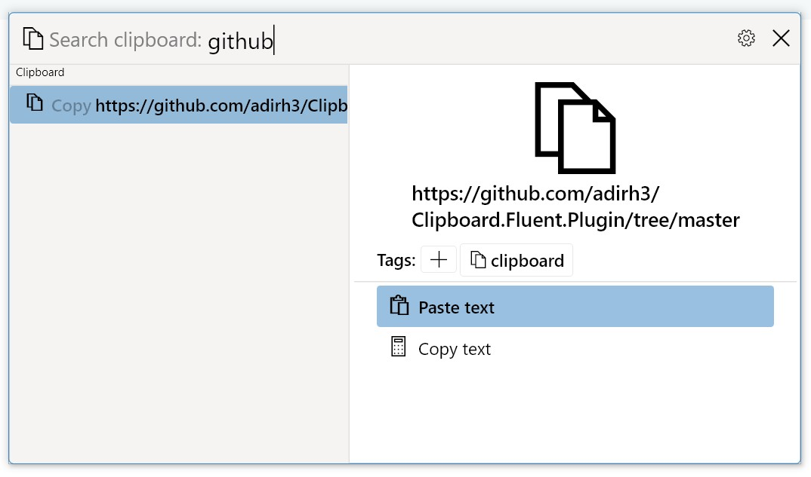

# Clipboard.Fluent.Plugin



This repo is for a [Fluent Search](https://fluentsearch.net) plugin for searching in clipboard history.

# Usage

Fluent Search will keep track of clipboard history (only once it is running)

1. Search for anything you copied
2. You can search using the "clipboard" search tag

## Images

Copied images are kept in the history as well (only when there is no text on the clipboard):

- Images are shown with a thumbnail, and can be pasted or copied back with the "Paste image" / "Copy image" actions.
- Text in the image is recognized with the Windows OCR built into Fluent Search, so you can search for it.
  The matching Windows OCR language pack needs to be installed (Windows Settings > Time & language > Language & region).
  If OCR isn't available, images can still be found by their size (e.g. `Image 1920x1080`).
- Images are stored as PNG files in `%APPDATA%\Blast\ClipboardImages`.
- Only the latest 30 images are kept. Images you keep (Keep result) stay after a restart, all other images are deleted
  when removed from the history, with "Clear all", or when Fluent Search starts.

# Building

```
dotnet build -c Release
```

builds against the `Blast.API` NuGet package. To build against an installed Fluent Search instead (so the API matches that
exact version) use the matching .NET SDK and pass its folder:

```
dotnet build -c Release -p:FluentSearchDir="C:\Program Files\Fluent Search"
```

